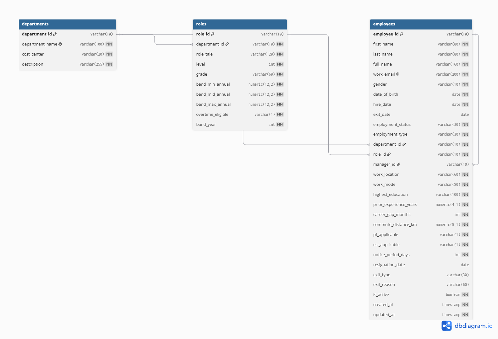

# Aura-Workforce

Backend for an HR management system, built with FastAPI and PostgreSQL. 

Task 1: a running app, settings from environment variables, a test, and Docker Compose.

## What you need

- Python 3.12
- Git
- Docker (with Docker Compose)

## Run with Docker

```
git clone https://github.com/Hemapriya2361/Aura-Workforce.git
cd hrms-api
copy .env.example .env
docker compose up --build
```

Then open:

- http://localhost:8000/health returns `{"status": "ok"}`
- http://localhost:8000/docs shows the automatic API page

Stop with `Ctrl+C`, and `docker compose down` to remove the containers.

## Run without Docker (for quick checks)

```
python -m venv venv
venv\Scripts\activate         # on Mac/Linux: source venv/bin/activate
pip install -r requirements.txt
uvicorn app.main:app --reload
```

## Run the tests

```
python -m pytest
```

Model tests use an in-memory SQLite database, so they need no Docker. They cover duplicate emails, missing required fields and the manager hierarchy.


Task 2: Tables were `departments`, `roles`, `employees`. Models are in `app/models/`, and field names follow the master dataset.

## Database



The diagram source is in `docs/er-diagram.dbml`.

**One role or many per employee?** One. Each employee has a single `role_id`, as in the master dataset. A single role means a single pay band, so payroll and reports stay simple. A role history table (like `employee_assignments` in the dataset) can be added later if changes over time are needed.

**Other design points**
- `manager_id` points back to `employees.employee_id`, which gives the manager and team hierarchy.
- `work_email` is unique. `full_name` and `department_id` are indexed for search.
- Soft delete: `is_active` is set to false instead of deleting the row.
- `created_at` and `updated_at` are filled automatically.

### Migrations

Run these inside Docker, because the database host is `db`:

```
docker compose up -d db
docker compose run --rm api alembic upgrade head      # build the schema
docker compose run --rm api alembic downgrade base    # roll everything back
docker compose run --rm api alembic revision --autogenerate -m "message"   # new migration
```

To start from a completely clean database: `docker compose down -v`, then run the upgrade again.

## Settings

Settings are read from environment variables, or from a `.env` file. `.env` is not committed. Copy `.env.example` and change the values.

Inside Docker the database host is the service name `db`, not `localhost`.

## Folder structure

```
app/
  main.py        app entry point and /health
  core/          settings (config.py) and database connection (database.py)
  routes/        API endpoints (Task 3)
  services/      business logic (Task 3)
  models/        database tables (Task 2)
  schemas/       request and response shapes (Task 3)
alembic/         database migrations
tests/           pytest tests
scripts/         seed script (Task 4)
docs/            API contract, sample data, ER diagram
```
